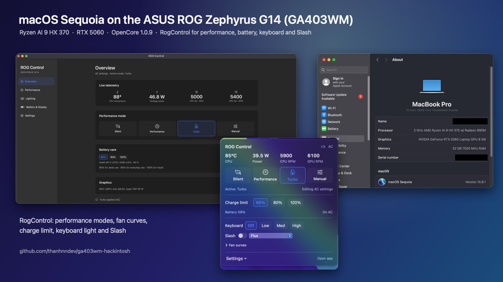
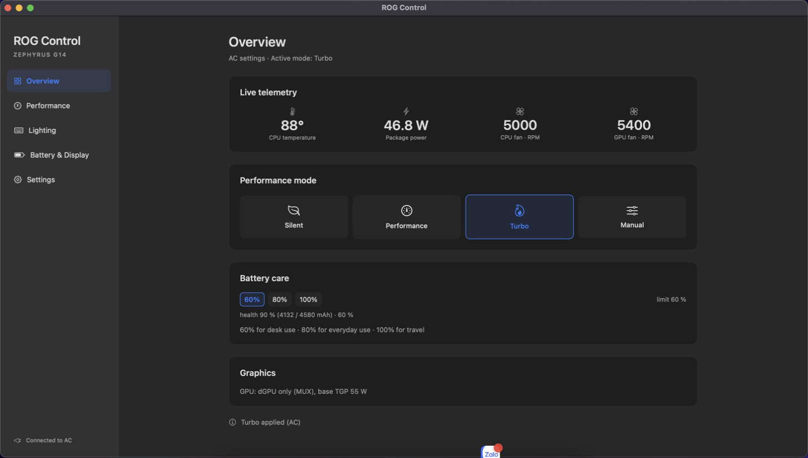
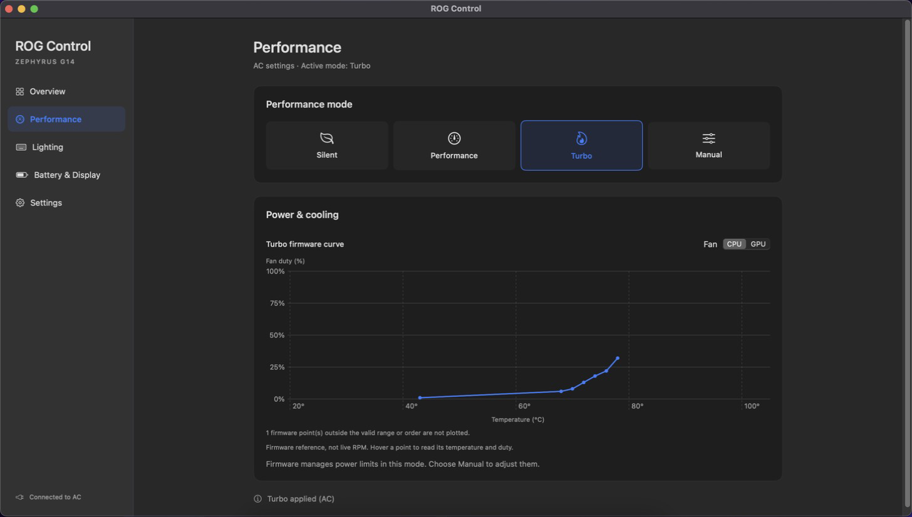

# GA403WM Hackintosh

## Vibe-coded project — read before installing

This is a vibe-coded, experimental project. **Almost all code and documentation was AI-written (Claude)**, directed and tested by one person, with no independent audit.

- Kexts run in the kernel; bugs can cause panics, hangs or data loss. `AsusWmi` and `AmdCppc` write to the EC, BIOS through SMI, and CPU registers.
- EFI settings are adapted from other projects: SIP is mostly disabled, AMFI is relaxed and Secure Boot is off.
- Injected Wi-Fi passwords are stored **in plain text inside the kext**. Never share a credential-injected kext. Logs also contain MAC addresses and nearby SSIDs/BSSIDs; redact them before posting.
- Back up your disk and keep Windows/Linux recovery media. Use a machine you can reinstall, and avoid work you cannot afford to lose. No warranty; see [LICENSE](LICENSE).

The repo ships empty `itl_ssid*/itl_psk*` fields and `CHANGE_ME_*` SMBIOS placeholders. CI checks for real credentials and identifiers.

## Overview

macOS Sequoia on the **ASUS ROG Zephyrus G14 (2025)** — Ryzen AI 9 HX 370 + RTX 5060 Laptop.
OpenCore EFI, custom drivers and utilities for this machine.

[Tiếng Việt](README.vi.md) · [Installation](docs/INSTALL.md) · [Releases](https://github.com/thanhnndev/ga403wm-hackintosh/releases) · [Roadmap](docs/ROADMAP.md)

<p align="center">
  
</p>

## Compatibility

Tested on **one GA403WM**, BIOS **GA403WM.310**, OLED **2880 × 1800 @ 120 Hz**. Other BIOS versions, panels and GA403 variants are untested. Status below: **2026-10-12**; dated test notes are in [HANDOFF](docs/HANDOFF.md).

| Requirement | Details |
|---|---|
| macOS | **15 Sequoia only**. Developed on 15.6.1; daily use on **15.8.1 (24H32)** |
| GPU mode | **Ultimate / dGPU-only MUX**. Radeon 890M has no driver and is hidden from macOS |
| Graphics driver | NullMoth **1.14.2** with two local patches; use the [GA403WM fork](https://github.com/thanhnndev/nvidia-macos-driver/tree/ga403wm) for OLED brightness |
| Bootloader | OpenCore **1.0.9** with the Zen 5 timer patch |

**macOS 26 Tahoe is unsupported and untested. Do not upgrade:** the NVIDIA driver supports macOS 15 only. Current daily use is plugged in with an external HDMI display; battery life has not been tested.

## Hardware status

Checked items are verified on the reference machine. Unchecked items are unreliable, unverified or unsupported.

- [x] **Boot / dual boot:** Internal ESP; Windows and Linux available in the OpenCore picker. [EFI](efi/README.md) · [Dual boot / UEFI recovery](docs/DUAL-BOOT.md)
- [x] **CPU:** 12 cores / 24 threads; CPPC and boost to ~4.9 GHz with `AmdCppc` + `AmdCppcPolicy`. [CPU power](docs/CPU-POWER.md)
- [x] **RTX 5060 / displays:** Internal OLED at 120 Hz and external display. [NVIDIA](docs/NULLMOTH.md)
- [x] **OLED brightness / HiDPI:** System slider and brightness keys control the panel through `NVRMEdpBL`. HiDPI **2×**, “looks like 1440 × 900”; fractional scales unsupported. [Brightness](docs/OLED-BRIGHTNESS-DPCD.md) · [HiDPI setup](docs/SCRIPTS.md#4-hidpi-looks-like-1440-x-900-step-by-step)
- [x] **USB keyboard, mouse, webcam:** `ItlXhciKick` fixes the 2-second key-release lag. Tested USB map pending in the standard EFI. [USB](docs/USB-XHCI-LAG.md)
- [x] **Touchpad:** I2C `093a:3011`; fixed 2026-10-12. [Test notes](docs/HANDOFF.md)
- [x] **MT7925 Wi-Fi:** `itlmt7925` (“legacy”): WPA2-PSK, DHCP, HE / 160 MHz at full link speed. Appears as **Ethernet**; requires SSID/password injection. No WPA3 or 6 GHz. [Wi-Fi](docs/WIFI.md) · [Driver selection](docs/WIFI-DRIVERS.md)
- [x] **MT7925 Bluetooth:** Classic headphones and BLE mice via `MtkBtFw` + `BtLeDlFix`. [Bluetooth](docs/BLUETOOTH.md)
- [x] **ROG controls / lighting:** Profiles, fans, charge limit, keyboard backlight and Slash lighting via `AsusWmi` + RogControl. [ROG controls](docs/ASUSCTL-MACOS.md)
- [ ] **Sleep / wake:** No reliable deep sleep; wake is slow and unreliable. Completed cycles restore CPU policy. Do not rely on lid close or sleep.
- [ ] **Other Fn keys:** Brightness and keyboard lighting work; most other keys are not mapped.
- [ ] **Audio / SD reader / battery %:** EFI includes AppleALC layout 33, Sinetek-rtsx and SMCBatteryManager; functionality is unverified.
- [x] **Native Wi-Fi (opt-in):** `itlmt7925Native` presents the MT7925 as a real Wi-Fi interface (Wi-Fi menu, join from System Settings, no credentials in the kext), 28-36 MB/s measured. Still being tested; the reference EFI stays on the legacy mode. [Which mode, how to enable, how to go back](docs/WIFI-DRIVERS.md)
- [ ] **AirDrop / AWDL / Continuity:** not working; research and phase plan in [docs/ROADMAP-AWDL.md](docs/ROADMAP-AWDL.md)


## Installation

> **The complete tested EFI is not available yet.** `efi/` and the release's `EFI-reference.zip` are sanitized references with placeholder SMBIOS, placeholder USB map and debug boot-args. The working EFI, including the tested USB map, is planned as a later release asset.

Follow **[INSTALL.md](docs/INSTALL.md)**. The main steps:

1. Back up the disk. Set BIOS MUX to **Ultimate**, Above 4G Decoding **ON**, CSM **OFF**, Secure Boot **OFF**.
2. Download the [v1 release](https://github.com/thanhnndev/ga403wm-hackintosh/releases): kexts, apps, CPU daemon, patched OpenCore, reference EFI and checksums. Or build on a Mac with `bash scripts/build.sh`. Add the [third-party kexts](efi/KEXTS.md).
3. Assemble the [EFI](efi/README.md), generate **your own SMBIOS**, and use the patched OpenCore (`fix-zen5-fsb.diff` fixes timers firing ~10× early).
4. [Inject your Wi-Fi network](docs/INSTALL.md#4-wi-fi-inject-your-network) into `itlmt7925.kext`, or use USB tethering. Legacy mode is the default; native Wi-Fi is opt-in with boot-args, see [WIFI-DRIVERS.md](docs/WIFI-DRIVERS.md).
5. Install macOS 15, then the [NVIDIA driver from the fork](docs/INSTALL.md#7-nvidia-driver-rtx-5060--the-oled), apps and CPU policy daemon. An offline installer is recommended; the 16 GB online installer is not suited to the current Wi-Fi path.

Release usage, install scripts, diagnostics and HiDPI setup: **[SCRIPTS.md](docs/SCRIPTS.md)**.

## Utilities and source

- **RogControl:** menu bar and window for Silent / Performance / Turbo / Manual profiles, SPL/SPPT/FPPT limits, CPU temperature/power, fan RPM and firmware curves, 60/80/100% charge limits, keyboard and Slash lighting. Separate AC/battery settings apply at login and source changes; lighting reapplies after wake. Turbo is disabled on battery. MUX is read-only; no per-key Aura or panel overdrive. Includes `--bench`.
- **ItlWiFi:** menu bar scanning, joining and speed tests for the Ethernet-backed Wi-Fi driver. The screenshot below is a placeholder.
- **TapGuard:** suppresses touchpad taps while typing.

Driver and app details, including `ItlDiag` boot diagnostics: **[COMPONENTS.md](docs/COMPONENTS.md)**.

| RogControl | Fan curves |
|---|---|
|  |  |

[Popover](docs/images/rogcontrol-popover.png) · [About This Mac](docs/images/about-this-mac.png) · [ItlWiFi placeholder](docs/images/itlwifi.svg) · [Screenshot notes](docs/images/README.md)

```text
efi/                OpenCore reference config, SSDTs, third-party kext list
kexts/              Wi-Fi, USB, ASUS controls, CPU, Bluetooth, diagnostics
macos/              RogControl, ItlWiFi, TapGuard, AmdCppcPolicy daemon
fw/                 MT7925 firmware from linux-firmware and its license
patches/opencore/   Zen 5 patch
scripts/            Build, install, credential injection, logs, EFI export/privacy check
tools/              Kernel-collection reader and display/CPU probes
test/               Host tests (WPA2, capabilities, Block Ack, etc.), run in CI
docs/               Guides, component reference, research and test notes
```

## Next steps

[ROADMAP.md](docs/ROADMAP.md) tracks branches and next actions: native Wi-Fi (keeping `itlmt7925` as fallback), sleep/wake, Fn keys, battery testing, audio/SD/battery verification, WindowServer performance and upstreaming the NVIDIA VRAM-clear/brightness patches. Also pending: a second owner's installation report, the first tagged release with CI-built kexts (CI app builds currently fail), and component-by-component cleanup after stability is established. macOS 26 waits until macOS 15 is stable.

## Contributing and license

Maintained by [thanhnndev](https://github.com/thanhnndev). GA403WM owners: use the **Hardware report** issue template and read [CONTRIBUTING.md](CONTRIBUTING.md).

Thanks to [NullMoth](https://github.com/nullmoth/1401) for the EFI base and NVIDIA driver, Acidanthera for OpenCore/Lilu/VirtualSMC/AppleALC, and Linux `mt76`, `btmtk`, `asus-wmi` and `asusctl` for design references. Full credits and licenses: [NOTICE.md](NOTICE.md).

Code uses the [Clear BSD License](LICENSE), including reimplementations of MediaTek's Linux `mt76` (BSD-3-Clause-Clear). Firmware has [MediaTek's license](fw/LICENCE.mediatek). **The EFI derives from `nullmoth/1401` and uses PolyForm Noncommercial 1.0.0: noncommercial use only.** The OLED brightness patches are in the `ga403wm` fork and have not been upstreamed.

Not affiliated with ASUS, Apple, NVIDIA, MediaTek, AMD or NullMoth. Trademarks belong to their owners; users are responsible for complying with Apple's macOS license terms.
