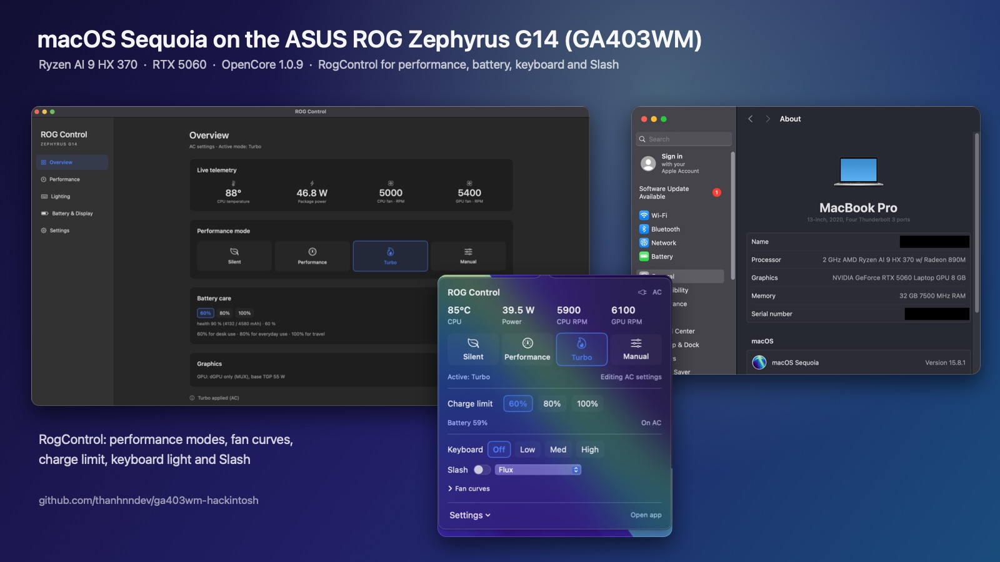

# GA403WM Hackintosh

> **This release (v2) targets macOS 26 Tahoe with the internal display on the Radeon 890M.**
> macOS 15 Sequoia is the previous release: [v1](https://github.com/thanhnndev/ga403wm-hackintosh/releases/tag/v1) and
> [kext-v1.1](https://github.com/thanhnndev/ga403wm-hackintosh/releases/tag/kext-v1.1). That is a different setup
> (display on the RTX 5060, 890M hidden); its guide is [docs/INSTALL.md](docs/INSTALL.md). The two do not mix.

## Vibe-coded project: read before installing

This is a vibe-coded, experimental project. **Almost all code and documentation was AI-written (Claude)**, directed and tested by one person on **one laptop**, with no independent audit. "Works" below means "worked on that machine on the date given in [docs/STATE-AND-ROADMAP.md](docs/STATE-AND-ROADMAP.md)".

- Kexts run in the kernel; bugs can cause panics, hangs or data loss. `NMXGPU` drives the display: a fault there can mean a black screen and a forced restart. `AsusWmi` and `AmdCppc` write to the EC, the BIOS and CPU registers; `RyzenHV` runs virtual machines in the kernel; `StrixSbxMap` adds an exception inside the macOS Sandbox; `VCNDec` and one sandbox rule are installed on the system volume.
- SIP is mostly disabled, AMFI is relaxed and Secure Boot is off.
- Logs, `ioreg` dumps and panic reports contain serial numbers, MAC addresses and nearby SSIDs/BSSIDs; redact them before posting.
- Back up your disk and keep Windows or Linux bootable: it was needed more than once during development to undo a GPU change. No warranty; see [LICENSE](LICENSE).

The repository ships `CHANGE_ME_*` SMBIOS placeholders. CI checks `efi/OC/config.plist` for real identifiers.

## Overview

macOS 26 Tahoe on the **ASUS ROG Zephyrus G14 (2025), GA403WM**: Ryzen AI 9 HX 370, Radeon 890M, RTX 5060 Laptop.
OpenCore EFI reference, documents and traces, 890M tooling and a few small kexts for this machine.

[Tiếng Việt](README.vi.md) · [**State and roadmap**](docs/STATE-AND-ROADMAP.md) · [v2 release notes](.github/release-notes/v2.md) · [Releases](https://github.com/thanhnndev/ga403wm-hackintosh/releases) · [macOS 15 install guide (v1)](docs/INSTALL.md)

<p align="center">
  
</p>

The screenshot is from the macOS 15 setup of October 2026; there is no Tahoe screenshot in the repository yet.

## Machine

| | |
|---|---|
| Laptop | ASUS ROG Zephyrus G14 2025, model GA403WM |
| macOS | 26 Tahoe, 26.7.2 (25G332, Darwin 25.6), installed on the internal disk |
| Bootloader | OpenCore 1.0.9 with the Zen 5 timer patch ([patches/opencore](patches/opencore)) |
| CPU | AMD Ryzen AI 9 HX 370 ("Strix Point": 4 Zen 5 + 8 Zen 5c cores, 24 threads) |
| iGPU | Radeon 890M. **Drives the internal display, WindowServer and all apps** through `NMXGPU` (Linux amdgpu source port) and a Metal-on-Vulkan plugin on RADV, from the [nvidia-macos-driver fork](https://github.com/thanhnndev/nvidia-macos-driver) |
| dGPU | NVIDIA GeForce RTX 5060 Laptop. Powered off at boot in Eco mode (`StrixDgpuGate`), or driven by [NullMoth's NVIDIA driver](https://github.com/nullmoth/nvidia-macos-driver) 2.7.1 in Standard mode. The HDMI port is wired to it |
| Display | 2880x1800 OLED, 120 Hz |
| Memory | 32 GB |
| Wi-Fi / Bluetooth | MediaTek MT7925: PCI `14c3:7925` (Wi-Fi), USB `0489:e11e` (Bluetooth) |
| Audio | Realtek ALC285 codec + two Cirrus CS35L56 amplifiers on I2C |
| USB | four AMD xHCI controllers `1022:151e`, `151f`, `151a`, `151b` |
| Input | I2C-HID touchpad `093a:3011`, USB keyboard `0b05:19b6` |
| Storage | NVMe SSD, Realtek SD-card reader |
| Sleep states | S0 idle, S4, S5 (the firmware has no S3) |

## What works

| Area | State | Notes | Where |
|---|---|---|---|
| Boot macOS 26.7.2 from the internal disk | works | Eco boot reaches the login window 14-33 s after kernel start | [docs/BOOT-TIMELINE.md](docs/BOOT-TIMELINE.md) |
| Zen 5 timer / FSB calculation | works | fixed by the OpenCore patch | [patches/opencore](patches/opencore) |
| Internal display on the 890M | works | 2880x1800 at 120 Hz, zero-copy page flips | [docs/FRAME-PATH.md](docs/FRAME-PATH.md) |
| Brightness (slider and keys) | works | handled inside NMXGPU | [docs/890M-ROADMAP.md](docs/890M-ROADMAP.md) |
| HiDPI | partly | "looks like 1440x900" and native only; no other scaled sizes | [docs/890M-TRACE.md](docs/890M-TRACE.md) |
| HDR | **not verified** | | |
| WindowServer and app Metal on the 890M | works | about 7 ms of CPU per frame in WindowServer (a real Mac: about 1 ms) | [docs/WS-CPU.md](docs/WS-CPU.md) |
| WebGL: Chrome, Edge, Safari | works | Safari needs `StrixSbxMap`, a pinned Sandbox exception | [docs/MAPS-WEBGL.md](docs/MAPS-WEBGL.md), [docs/890M-ROADMAP.md](docs/890M-ROADMAP.md) |
| Hardware video decode (H.264, HEVC, VP9, AV1; 8 and 10 bit) | works | `VCNDec` on the 890M VCN; 58 of 59 matrix cells in Chrome, Safari and QuickTime (measured on 0.2.0; 0.2.1 is live and was tested in-process only). Hardware encode: not verified | [docs/VIDEO-CODEC-MATRIX.md](docs/VIDEO-CODEC-MATRIX.md) |
| RTX 5060, Eco mode | works | card off and off the PCI bus; no HDMI in this mode; untested with sleep and charger events | [docs/BOOT-TIMELINE.md](docs/BOOT-TIMELINE.md) |
| RTX 5060, Standard mode | partly | the NVIDIA kernel stack boots; apps get no Metal device from the RTX; HDMI not re-tested; switching needs a reboot | [docs/890M-ROADMAP.md](docs/890M-ROADMAP.md) |
| Wi-Fi | works | native Wi-Fi menu, WPA2-PSK on 2.4/5 GHz, HE 160 MHz. No WPA3, open networks, 6 GHz, AirDrop | [mt7925-macos](https://github.com/thanhnndev/mt7925-macos) |
| Bluetooth | works | BLE mouse in daily use; keyboard pairing not recorded | [mt7925-macos](https://github.com/thanhnndev/mt7925-macos/blob/main/docs/BLUETOOTH.md) |
| Speakers | works | all four drivers; needs `StrixAmp` and the RogAudio driver | [docs/AUDIO-TAHOE.md](docs/AUDIO-TAHOE.md) |
| Microphones | partly | internal pair and noise reduction work; third microphone unreachable; gain sometimes resets to minimum | docs/AUDIO-ROG.md (branch `research/audio-rog-dolby`) |
| Headphone jack | **not verified** on Tahoe | | |
| Keyboard, USB devices | works | `ItlXhciKick` fixes the 2 s key-release lag | [docs/USB-XHCI-LAG.md](docs/USB-XHCI-LAG.md) |
| Fn keys | partly | mute and volume native; the rest through `rogkeyd`; Fn+F6 and Fn+F10 not mapped | [rog-control-macos](https://github.com/thanhnndev/rog-control-macos) |
| Touchpad | works | VoodooI2C in forced polling mode | [efi/KEXTS.md](efi/KEXTS.md) |
| Webcam | works | UVC | |
| SD card reader | **not verified** | driver loaded | |
| ASUS profiles, fan curves, power limits, charge limit, keyboard light | works | `AsusWmi` + RogControl | [docs/PLATFORM-LIMITS.md](docs/PLATFORM-LIMITS.md), [rog-control-macos](https://github.com/thanhnndev/rog-control-macos) |
| Sleep / wake | partly | S0 idle sleep with lid and power-button wake passed on 2026-11-07; **not re-tested on the current stack**; S0i3 not reached | [docs/890M-TRACE.md](docs/890M-TRACE.md) |
| Shut Down | works | stays off | [docs/SHUTDOWN-TIMELINE.md](docs/SHUTDOWN-TIMELINE.md) |
| Power and heat | partly | light work 17 W / 57 C (2026-11-23); Docker + emulator load 62 W / 95 C (2026-11-16, not re-measured); GPU power follows the compositing rate (static screen 0.09 W on the GFX rail and 6.2 W socket, 81-91 flips/s 12.4-19.3 W; read 2026-11-25); no controlled idle-floor measurement; battery life in Eco not measured | [docs/POWER-UNDER-LOAD.md](docs/POWER-UNDER-LOAD.md), [docs/POWER-FEATURES.md](docs/POWER-FEATURES.md), [docs/POWER-FLOOR.md](docs/POWER-FLOOR.md) |
| Docker Desktop | works | on `RyzenHV` (AMD SVM hypervisor kext) | [docs/RYZENHV-GUEST-MEM.md](docs/RYZENHV-GUEST-MEM.md) |
| Android emulator | works | boots since RyzenHV 0.7.24 (verified 2026-11-25; cold boot 24-32 s on a scratch AVD). The first start after the update must be a cold boot (Device Manager > Cold Boot Now): a snapshot saved from a stalled guest restores the stall. Restoring a snapshot from a healthy boot and host-GPU rendering are **not verified** (tested with the default software GPU) | [docs/STATE-AND-ROADMAP.md](docs/STATE-AND-ROADMAP.md) |
| iOS Simulator | works | renders on the 890M, 60 fps in the bench | [docs/SIMULATOR-PERF.md](docs/SIMULATOR-PERF.md) |
| Reference EFI in `efi/` | partly | `config.plist` and SSDTs exported from the live Tahoe ESP on 2026-11-25. **A reference for this one machine, not a ready-to-boot EFI**: serial, MLB, UUID and ROM are placeholders, the 890M `vbios` property is emptied (put your own card's VBIOS image back), kexts are not included (32 third-party kexts listed by hash) | [efi/README.md](efi/README.md) |
| Fresh install on a blank disk | partly | done once by hand; no tested guide or installer yet | [docs/FRESH-INSTALL.md](docs/FRESH-INSTALL.md) |

Dates, evidence, exact versions and known issues: [docs/STATE-AND-ROADMAP.md](docs/STATE-AND-ROADMAP.md).

## What is in this repository

This repository holds the EFI reference, the documents and traces, the 890M tooling and a few small kexts. The larger
drivers live in their own repositories; their sources were removed from this one (the history stays here):

| Repository | What |
|---|---|
| this repository | everything listed below |
| [nvidia-macos-driver](https://github.com/thanhnndev/nvidia-macos-driver) (fork of NullMoth's, PolyForm Noncommercial) | `NMXGPU`, `NMXAccel`, `NMXAGDC`, the Metal plugin and shader translator for the 890M |
| [mt7925-macos](https://github.com/thanhnndev/mt7925-macos) | MT7925 Wi-Fi (`itlmt7925`, `itlmt7925Native`) and Bluetooth (`MtkBtFw`, `BtLeDlFix`) |
| [rog-control-macos](https://github.com/thanhnndev/rog-control-macos) | `AsusWmi`, `AmdCppc`, `StrixDgpuGate`, the RogControl app, `rogkeyd`, the CPU policy daemon |
| [ryzen-hypervisor.framework](https://github.com/thanhnndev/ryzen-hypervisor.framework) (fork of OverlordDev's) | `RyzenHV` |
| [strix-890m-macos](https://github.com/thanhnndev/strix-890m-macos) | a copy of the earlier boot-display kexts and traces (last push 2026-11-02). The same files are still here; which repository is their home is not decided |

```
efi/                 OpenCore config.plist + SSDTs exported from the live Tahoe ESP on 2026-11-25 (serial/MLB/UUID/ROM
                     are placeholders, the vbios property is emptied) and the third-party kext list. A reference, not
                     a ready-to-boot EFI
kexts/ItlXhciKick    keeps the second xHCI event ring serviced on single-vector AMD controllers (fixes the USB lag)
kexts/StrixS0ix      S0 idle sleep: PMC hints, CPU parking, lid and power-button wake
kexts/StrixSbxMap    Lilu plugin: lets the WebKit GPU process map the pinned 890M Metal plugin files (Safari WebGL)
kexts/ItlDiag        boot diagnostics that log to NVRAM; a debugging aid
kexts/StrixGOP, StrixAccel, StrixMetalGate, StrixHeadroom, StrixProbe
                     the earlier boot-display research; superseded by NMXGPU and switched off on the reference machine
macos/TapGuard       ignores touchpad taps while typing
tools/890m/vcndec    VCNDec: VideoToolbox decoder on the 890M VCN (H.264, HEVC, VP9, AV1)
tools/890m/video-suite  local, ad-free video test suite and the codec matrix results
tools/890m/          Metal, Vulkan and DRM probes, WebGL repro, frame-path and power read-out scripts
tools/               OpenCore config editor, kernel-collection readers, health and idle probes, simulator bench
scripts/             kext build, install and undo scripts for each piece, RADV build, EFI export and privacy check,
                     recovery from Linux and Windows. Many install-step scripts are tied to the reference machine's
                     history and are kept as a record, not as an installer
patches/opencore/    OpenCorePkg patch for Zen 5
patches/nmx, patches/power-floor  patches against the NMXGPU source tree (the fork is the source of truth)
abi/, include/, acpi/  ACPI dumps, ABI notes and headers used by the research
test/                host tests for the config and Strix tools
docs/                state and roadmap, the 890M trace, frame path, video, power, boot and shutdown, install design
```

`scripts/build.sh` builds `ItlXhciKick` and `ItlDiag` by default and the `Strix*` kexts when named. Not buildable from
this branch: `StrixAmp` and the RogAudio driver (branch `research/audio-rog-dolby`), and everything in the repositories
above. Bundle ids of the older kexts start with `com.itlmt7925.` (the Wi-Fi driver started the project); newer ones use
`com.ga403wm.`.

## Installation

**There is no tested step-by-step guide for a fresh Tahoe install.** The stack was installed once from scratch, by hand,
on 2026-11-07. What exists:

- the install order that worked, undo and recovery: [v2 release notes](.github/release-notes/v2.md);
- the design that came out of that install and its lessons: [docs/FRESH-INSTALL.md](docs/FRESH-INSTALL.md),
  [docs/FRESH-INSTALL-LESSONS-2026-11-07.md](docs/FRESH-INSTALL-LESSONS-2026-11-07.md);
- the notes of the move from macOS 15: [docs/TAHOE-MIGRATION.md](docs/TAHOE-MIGRATION.md).

Many step scripts under `scripts/` accept only the exact binaries of the reference machine's history. Read a script
before running it.

For **macOS 15** follow [docs/INSTALL.md](docs/INSTALL.md) with the [v1](https://github.com/thanhnndev/ga403wm-hackintosh/releases/tag/v1)
assets. [docs/SCRIPTS.md](docs/SCRIPTS.md) and [docs/COMPONENTS.md](docs/COMPONENTS.md) also describe that setup.

## Next steps

[docs/STATE-AND-ROADMAP.md](docs/STATE-AND-ROADMAP.md), section 5, is the roadmap for this release: a hardware colour
pipeline (so the per-frame colour pass on the GPU goes away), a hardware cursor plane, who drives the flips under the
daily load and damage-sized composition, WindowServer's idle surface imports, RyzenHV follow-ups, and the items still
not verified (sleep on the current stack, HDR, hardware encode). [docs/ROADMAP.md](docs/ROADMAP.md) is the older
macOS 15 work tracker.

## Credits

This setup stands on other people's work. The list covers what the reference machine really uses (checked against
`efi/kexts.json`, `efi/OC/config.plist`, `NOTICE.md` and the build scripts) and the code the drivers were derived from.
Third-party binaries are not redistributed here; licences are in [NOTICE.md](NOTICE.md) and in each project.

**Boot and kernel patches**

| Project | Used for |
|---|---|
| [OpenCore](https://github.com/acidanthera/OpenCorePkg) (acidanthera) | the boot loader; `patches/opencore/fix-zen5-fsb.diff` is a patch against its `OcCpuLib` |
| [nullmoth/1401](https://github.com/nullmoth/1401) (NullMoth) | the base OpenCore configuration and SSDTs that `efi/` derives from |
| [AMD_Vanilla](https://github.com/AMD-OSX/AMD_Vanilla) kernel patches (AMD-OSX; patch comments name algrey, XLNC, Shaneee, Zormeister, Goldfish64, Visual, laobamac) and CaseySJ's IOPCIFamily patches | the `Kernel > Patch` entries that let XNU run on an AMD CPU, as shipped by the base configuration |
| [Dortania](https://dortania.github.io/OpenCore-Install-Guide/) guides | read during the bring-up; source of `AppleMCEReporterDisabler` |
| [MacKernelSDK](https://github.com/acidanthera/MacKernelSDK) (acidanthera) | kernel headers and libraries for `scripts/build.sh` |

**Kexts on the ESP (third-party)**

| Project | Used for |
|---|---|
| [Lilu](https://github.com/acidanthera/Lilu) (acidanthera) | patching framework for the plug-ins below and for `StrixSbxMap`, `BtLeDlFix` |
| [VirtualSMC](https://github.com/acidanthera/VirtualSMC) with SMCBatteryManager and SMCLightSensor (acidanthera) | SMC emulation, battery status; the light-sensor plug-in is on the ESP but disabled |
| [AppleALC](https://github.com/acidanthera/AppleALC) (acidanthera) | ALC285 codec (a local build with a GA403WM layout) |
| [SimpleHDA](https://github.com/laobamac/SimpleHDA) (laobamac) | brings AppleHDA back on macOS 26 |
| [WhateverGreen](https://github.com/acidanthera/WhateverGreen) (acidanthera) | on the ESP, disabled in this configuration |
| [NVMeFix](https://github.com/acidanthera/NVMeFix) (acidanthera) | NVMe power management |
| [BrightnessKeys](https://github.com/acidanthera/BrightnessKeys) (acidanthera) | brightness hot keys |
| [RestrictEvents](https://github.com/acidanthera/RestrictEvents) (acidanthera) | CPU name and the `sbvmm` patch |
| [BlueToolFixup](https://github.com/acidanthera/BrcmPatchRAM) (acidanthera, BrcmPatchRAM) | lets `bluetoothd` accept a non-Apple controller |
| [AMFIPass](https://github.com/dortania/OpenCore-Legacy-Patcher) (dhinakg, shipped with OpenCore Legacy Patcher) | lets platform binaries load the ad hoc signed driver bundles |
| [USBToolBox](https://github.com/USBToolBox/kext) (dhinakg) | USB port map |
| [VoodooI2C](https://github.com/VoodooI2C/VoodooI2C), [VoodooI2CHID](https://github.com/VoodooI2C/VoodooI2CHID), VoodooGPIO, VoodooInput | the I2C-HID touchpad |
| [NullEthernet](https://github.com/RehabMan/OS-X-Null-Ethernet) (RehabMan) | the fake `en0` |
| [ForgedInvariant](https://github.com/ChefKissInc/ForgedInvariant) (ChefKiss) | TSC synchronisation on AMD |
| [Sinetek-rtsx](https://github.com/sinetek/Sinetek-rtsx) | Realtek SD-card reader driver (loaded; function not verified) |
| [HoRNDIS](https://github.com/jwise/HoRNDIS) (Joshua Wise) | USB tethering from an Android phone while installing |
| AppleMCEReporterDisabler | stops the AppleIntelMCEReporter panic on AMD |

**GPU, video and virtualization**

| Project | Used for |
|---|---|
| [NullMoth's NVIDIA driver for macOS](https://github.com/nullmoth/nvidia-macos-driver) (NullMoth) | the RTX 5060 driver in Standard mode, and the NMX stack (`NMXGPU`, `NMXAccel`, the Metal plugin and translator) that the 890M work is a [fork](https://github.com/thanhnndev/nvidia-macos-driver) of |
| The Linux kernel's [amdgpu and DRM](https://gitlab.freedesktop.org/drm/kernel) (AMD and the DRM maintainers) | the driver source `NMXGPU` is a port of (display core included), and the reference flow the documents compare against |
| FreeBSD [drm-kmod](https://github.com/freebsd/drm-kmod) and LinuxKPI ([freebsd-src](https://github.com/freebsd/freebsd-src)) | the copy of amdgpu that is built, and the compatibility layer the port's "xkpi" layer comes from |
| [Mesa](https://gitlab.freedesktop.org/mesa/mesa) / RADV, with libdrm and glslang | the Vulkan driver under the Metal plugin and the VCN video decode (built with `scripts/radv`) |
| [FFmpeg](https://ffmpeg.org/) (libavcodec, LGPL build) and the Khronos Vulkan headers | `VCNDec`: Vulkan video decode of H.264, HEVC, VP9 and AV1 (`tools/890m/vcndec/ff-build.sh`) |
| [ryzen-hypervisor.framework](https://github.com/OverlordDev/ryzen-hypervisor.framework) (OverlordDev) | `RyzenHV`, the SVM hypervisor Docker and the Android emulator run on; the machine runs a [fork](https://github.com/thanhnndev/ryzen-hypervisor.framework) |

**Wi-Fi, Bluetooth and ASUS controls (through the sibling repositories)**

| Project | Used for |
|---|---|
| The Linux kernel's `mt76` / `mt7925` and `btmtk` drivers, and MediaTek's MT7925 firmware | hardware layer, reference and firmware of [mt7925-macos](https://github.com/thanhnndev/mt7925-macos) |
| [asusctl](https://gitlab.com/asus-linux/asusctl) / [asus-linux.org](https://asus-linux.org/) and the Linux `asus-wmi` / `asus-armoury` drivers | reference for the ASUS WMI and EC interface in [rog-control-macos](https://github.com/thanhnndev/rog-control-macos) |
| G-Helper, itlwm, k10temp | further design references, listed in the `NOTICE.md` of the two sibling repositories |

**Authoring**

| | |
|---|---|
| [Claude](https://www.anthropic.com/claude) (Anthropic) | wrote almost all of the code and documents of this project, directed and tested by the maintainer |

## Contributing and license

Maintained by [thanhnndev](https://github.com/thanhnndev). GA403WM owners: use the **Hardware report** issue template and read [CONTRIBUTING.md](CONTRIBUTING.md).

Credits for the projects this setup uses or derives from: [Credits](#credits) above. Licences: [NOTICE.md](NOTICE.md).

Code in this repository uses the [Clear BSD License](LICENSE). **The EFI derives from `nullmoth/1401`, and everything from the nvidia-macos-driver fork (NMXGPU, NMXAccel, the Metal plugin, the translator) is PolyForm Noncommercial 1.0.0: noncommercial use only**; none of the fork's code is in this repository's release assets.

Not affiliated with ASUS, Apple, NVIDIA, MediaTek, AMD or NullMoth. Trademarks belong to their owners; users are responsible for complying with Apple's macOS license terms.
