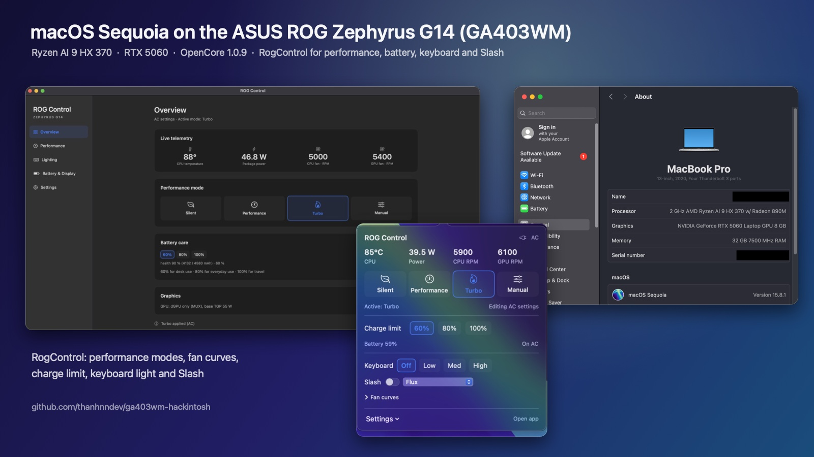

# GA403WM Hackintosh

## Dự án vibe-code — đọc trước khi cài

Đây là dự án vibe-code, đang ở mức thử nghiệm. **Gần như toàn bộ mã và tài liệu do AI (Claude) viết**, được một người hướng dẫn và test; chưa có audit độc lập.

- Kext chạy trong kernel; lỗi có thể gây panic, treo máy hoặc mất dữ liệu. `AsusWmi` và `AmdCppc` ghi vào EC, BIOS qua SMI và thanh ghi CPU.
- EFI được chỉnh từ các dự án khác: SIP gần như tắt, AMFI nới lỏng, Secure Boot tắt.
- Mật khẩu Wi-Fi đã inject được lưu **dạng văn bản thuần trong kext**. Đừng chia sẻ kext chứa mật khẩu. Log cũng chứa địa chỉ MAC và SSID/BSSID xung quanh; che trước khi đăng.
- Backup ổ đĩa và giữ USB cứu hộ Windows/Linux. Chỉ cài trên máy có thể cài lại; tránh dùng cho công việc không được phép mất dữ liệu. Không bảo hành; xem [LICENSE](LICENSE).

Repo để trống `itl_ssid*/itl_psk*` và dùng SMBIOS giữ chỗ `CHANGE_ME_*`. CI kiểm tra thông tin đăng nhập và định danh thật bị lọt vào repo.

## Giới thiệu

macOS Sequoia trên **ASUS ROG Zephyrus G14 (2025)** — Ryzen AI 9 HX 370 + RTX 5060 Laptop.
EFI OpenCore, driver và tiện ích dành cho máy này.

[English](README.md) · [Cài đặt](docs/INSTALL.vi.md) · [**Driver Wi-Fi MT7925**](https://github.com/thanhnndev/mt7925-macos) · [Release](https://github.com/thanhnndev/ga403wm-hackintosh/releases) · [Roadmap](docs/ROADMAP.md)

<p align="center">
  
</p>

## Các repo

Repo này giữ EFI OpenCore, hướng dẫn cài đặt và vài bản sửa nhỏ. Các phần lớn nằm ở repo riêng:

| Repo | Nội dung |
|---|---|
| **[mt7925-macos](https://github.com/thanhnndev/mt7925-macos)** | Wi-Fi MediaTek MT7925 (menu Wi-Fi native, chế độ Ethernet cũ, việc AWDL) và Bluetooth (`MtkBtFw`, `BtLeDlFix`) |
| **[rog-control-macos](https://github.com/thanhnndev/rog-control-macos)** | ROG Control Center: kext `AsusWmi` và `AmdCppc`, app thanh menu RogControl, daemon chính sách CPU |
| **[strix-890m-macos](https://github.com/thanhnndev/strix-890m-macos)** | Nghiên cứu Radeon 890M: kext màn hình khởi động, công cụ và trace. Chưa phải driver hoàn chỉnh |
| repo này | `efi/` (OpenCore), tài liệu cài và khôi phục, `ItlXhciKick` (lag USB), `TapGuard`, `ItlDiag` |

Mã nguồn của ba repo đầu đã gỡ khỏi repo này; lịch sử vẫn còn ở đây và việc phát triển tiếp tục ở các repo mới.

## Tương thích

Đã test trên **một chiếc GA403WM**, BIOS **GA403WM.310**, OLED **2880 × 1800 @ 120 Hz**. BIOS, panel và biến thể GA403 khác chưa được test. Tình trạng bên dưới cập nhật ngày **2026-10-12**; bằng chứng và lịch sử test nằm trong [HANDOFF](docs/HANDOFF.md).

| Yêu cầu | Chi tiết |
|---|---|
| macOS | Chỉ **15 Sequoia**. Phát triển trên 15.6.1; đang dùng hằng ngày trên **15.8.1 (24H32)** |
| Chế độ GPU | **Ultimate / MUX chỉ dùng dGPU**. Radeon 890M không có driver và bị ẩn khỏi macOS (nghiên cứu: [strix-890m-macos](https://github.com/thanhnndev/strix-890m-macos)) |
| Driver đồ họa | NullMoth **1.14.2** với hai bản vá riêng; dùng [fork GA403WM](https://github.com/thanhnndev/nvidia-macos-driver/tree/ga403wm) để có độ sáng OLED |
| Bootloader | OpenCore **1.0.9** với bản vá timer Zen 5 |

**macOS 26 Tahoe chưa hỗ trợ, chưa test. Đừng nâng cấp:** driver NVIDIA chỉ hỗ trợ macOS 15. Hiện máy được dùng hằng ngày khi cắm sạc và nối màn hình ngoài qua HDMI; thời lượng pin chưa test.

## Tình trạng phần cứng

Mục đã đánh dấu được kiểm chứng trên máy tham chiếu. Mục chưa đánh dấu còn lỗi, chưa kiểm chứng hoặc chưa hỗ trợ.

- [x] **Boot / dual boot:** Boot từ ESP trong máy; chọn Windows/Linux trong OpenCore. [EFI](efi/README.md) · [Dual boot / khôi phục UEFI](docs/DUAL-BOOT.md)
- [x] **CPU:** 12 nhân / 24 luồng; CPPC và boost ~4,9 GHz nhờ `AmdCppc` + `AmdCppcPolicy`. [CPU](docs/CPU-POWER.md)
- [x] **RTX 5060 / màn hình:** OLED trong máy ở 120 Hz và màn hình ngoài. [NVIDIA](docs/NULLMOTH.md)
- [x] **Độ sáng OLED / HiDPI:** Thanh trượt hệ thống và phím độ sáng điều khiển panel qua `NVRMEdpBL`. HiDPI **2×**, “looks like 1440 × 900”; không hỗ trợ tỉ lệ lẻ. [Độ sáng](docs/OLED-BRIGHTNESS-DPCD.md) · [Cài HiDPI](docs/SCRIPTS.vi.md#4-hidpi-looks-like-1440-x-900-từng-bước)
- [x] **Phím, chuột USB, webcam:** `ItlXhciKick` sửa lỗi nhả phím trễ 2 giây. USB map đã test sẽ đi kèm EFI chuẩn. [USB](docs/USB-XHCI-LAG.md)
- [x] **Touchpad:** I2C `093a:3011`; sửa xong ngày 2026-10-12. [Ghi chép test](docs/HANDOFF.md)
- [x] **Wi-Fi MT7925:** đã tách sang repo riêng **[mt7925-macos](https://github.com/thanhnndev/mt7925-macos)**: Wi-Fi native (menu Wi-Fi, kết nối từ System Settings) trên macOS 15 và 26, chế độ legacy kiểu Ethernet, hướng dẫn, roadmap và release. [Hướng dẫn cài](https://github.com/thanhnndev/mt7925-macos/blob/main/docs/GUIDE.vi.md)
- [x] **Bluetooth MT7925:** Tai nghe classic và chuột BLE qua `MtkBtFw` + `BtLeDlFix`, nay ở **[mt7925-macos](https://github.com/thanhnndev/mt7925-macos/blob/main/docs/BLUETOOTH.md)** ([release bt-v1.0](https://github.com/thanhnndev/mt7925-macos/releases/tag/bt-v1.0)).
- [x] **Điều khiển ROG / đèn:** Profile, quạt, giới hạn sạc, đèn bàn phím và Slash qua `AsusWmi` + RogControl, nay ở **[rog-control-macos](https://github.com/thanhnndev/rog-control-macos)**.
- [ ] **Sleep / wake:** Chưa có deep sleep ổn định; wake chậm và thiếu ổn định. Chu kỳ hoàn tất khôi phục được chính sách CPU. Đừng trông cậy vào sleep hay đóng nắp.
- [ ] **Các phím Fn khác:** Độ sáng và đèn bàn phím hoạt động; phần lớn phím còn lại chưa map.
- [ ] **Âm thanh / đầu đọc SD / % pin:** EFI có AppleALC layout 33, Sinetek-rtsx và SMCBatteryManager; chưa kiểm chứng hoạt động.
- [ ] **AirDrop / AWDL / Continuity:** chưa chạy; đang làm ở [mt7925-macos](https://github.com/thanhnndev/mt7925-macos/blob/main/docs/ROADMAP-AWDL.md) (nhánh `dev/awdl`)


## Cài đặt

> **Chưa có EFI hoàn chỉnh đã test.** Thư mục `efi/` và `EFI-reference.zip` trong release là bản tham khảo đã làm sạch: SMBIOS giữ chỗ, USB map giữ chỗ và boot-args debug. EFI đang chạy, kèm USB map đã test, dự kiến được bổ sung vào release sau.

Làm theo **[INSTALL.vi.md](docs/INSTALL.vi.md)**. Các bước chính:

1. Backup ổ đĩa. Trong BIOS: MUX **Ultimate**, Above 4G Decoding **ON**, CSM **OFF**, Secure Boot **OFF**.
2. Tải [release v1](https://github.com/thanhnndev/ga403wm-hackintosh/releases): `ItlXhciKick`, `ItlDiag`, TapGuard, OpenCore đã vá, EFI tham khảo và checksum. Hoặc build trên Mac bằng `bash scripts/build.sh`. Thêm [kext bên thứ ba](efi/KEXTS.md).
3. Ghép [EFI](efi/README.md), **tự tạo SMBIOS**, dùng OpenCore đã vá (`fix-zen5-fsb.diff` sửa timer chạy sớm ~10 lần).
4. Wi-Fi: cài `itlmt7925.kext` (+ `itlmt7925Native.kext` để có menu Wi-Fi) từ **[mt7925-macos](https://github.com/thanhnndev/mt7925-macos/releases)** theo [hướng dẫn](https://github.com/thanhnndev/mt7925-macos/blob/main/docs/GUIDE.vi.md), hoặc dùng USB tethering.
5. Cài macOS 15, rồi cài [driver NVIDIA từ fork](docs/INSTALL.vi.md#7-driver-nvidia-rtx-5060--oled), rồi `AsusWmi` / RogControl / daemon CPU từ [rog-control-macos](https://github.com/thanhnndev/rog-control-macos/releases) và Bluetooth từ [mt7925-macos](https://github.com/thanhnndev/mt7925-macos/releases/tag/bt-v1.0). Nên dùng bộ cài offline; bộ cài online 16 GB không phù hợp với driver Wi-Fi hiện tại.

Cách dùng release, script cài đặt, chẩn đoán và HiDPI: **[SCRIPTS.vi.md](docs/SCRIPTS.vi.md)**.

## Tiện ích và mã nguồn

- **RogControl** (nay phát triển ở [rog-control-macos](https://github.com/thanhnndev/rog-control-macos)): thanh menu và cửa sổ cho profile Silent / Performance / Turbo / Manual, giới hạn SPL/SPPT/FPPT, nhiệt độ/công suất CPU, tốc độ và đường cong quạt firmware, giới hạn sạc 60/80/100%, đèn bàn phím và Slash. Cài đặt AC/pin riêng, áp lại khi đăng nhập hoặc đổi nguồn; đèn áp lại sau wake. Turbo tắt khi dùng pin. MUX chỉ đọc; chưa có Aura từng phím hay overdrive panel. Có `--bench`.
- **ItlWiFi** (app thanh menu cho chế độ Wi-Fi kiểu Ethernet) đã chuyển sang [mt7925-macos](https://github.com/thanhnndev/mt7925-macos).
- **TapGuard:** bỏ qua tap touchpad khi đang gõ.

Chi tiết driver và app, gồm công cụ chẩn đoán boot `ItlDiag`: **[COMPONENTS.md](docs/COMPONENTS.md)**.

Ảnh chụp app ROG Control: [rog-control-macos](https://github.com/thanhnndev/rog-control-macos#ảnh-chụp).

[About This Mac](docs/images/about-this-mac.png) · [Ghi chú ảnh](docs/images/README.md)

```text
efi/                Config OpenCore tham khảo, SSDT, danh sách kext bên thứ ba
kexts/              ItlXhciKick (lag USB), ItlDiag (chẩn đoán)
macos/              TapGuard
patches/opencore/   Bản vá Zen 5
scripts/            Build, cài đặt, inject mạng, log, export EFI/kiểm tra riêng tư
tools/              Đọc kernel collection, kiểm tra màn hình và CPU
test/               Test trên host (WPA2, capabilities, Block Ack…), chạy trong CI
docs/               Hướng dẫn, thành phần, nghiên cứu và ghi chép test
```

## Việc tiếp theo

[ROADMAP.md](docs/ROADMAP.md) theo dõi nhánh và bước tiếp theo: sleep/wake, phím Fn, test pin, kiểm chứng âm thanh/SD/% pin, hiệu năng WindowServer và gửi bản vá NVIDIA VRAM-clear/độ sáng lên upstream. Còn chờ báo cáo cài đặt từ chủ máy thứ hai, bản release có tag đầu tiên với kext build bằng CI (bước build app trong CI đang lỗi), và dọn mã từng thành phần sau khi ổn định. macOS 26 chờ macOS 15 ổn định trước.

## Đóng góp và giấy phép

Tác giả và người duy trì: [thanhnndev](https://github.com/thanhnndev). Chủ máy GA403WM có thể gửi issue theo mẫu **Hardware report**; đọc [CONTRIBUTING.md](CONTRIBUTING.md).

Cảm ơn [NullMoth](https://github.com/nullmoth/1401) cho nền EFI và driver NVIDIA, Acidanthera cho OpenCore/Lilu/VirtualSMC/AppleALC, cùng Linux `mt76`, `btmtk`, `asus-wmi` và `asusctl` cho thiết kế tham khảo. Ghi công và giấy phép đầy đủ: [NOTICE.md](NOTICE.md).

Mã dùng [Clear BSD License](LICENSE), gồm phần viết lại từ Linux `mt76` của MediaTek (BSD-3-Clause-Clear).  **EFI dẫn xuất từ `nullmoth/1401`, dùng PolyForm Noncommercial 1.0.0: chỉ sử dụng phi thương mại.** Bản vá độ sáng OLED nằm trong fork nhánh `ga403wm`, chưa gửi upstream.

Không liên kết với ASUS, Apple, NVIDIA, MediaTek, AMD hay NullMoth. Nhãn hiệu thuộc chủ sở hữu tương ứng; người dùng tự chịu trách nhiệm tuân thủ giấy phép macOS của Apple.
