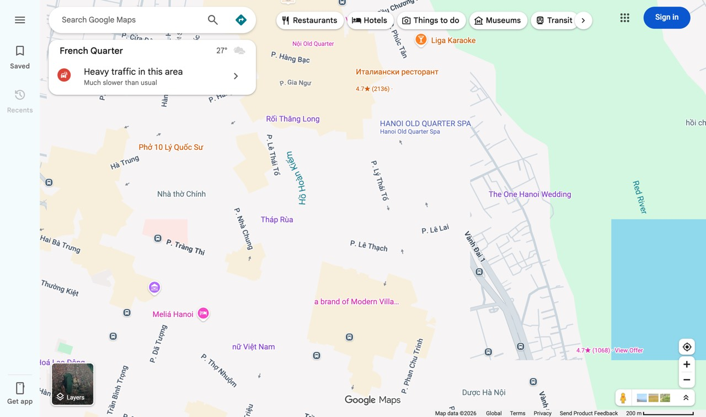
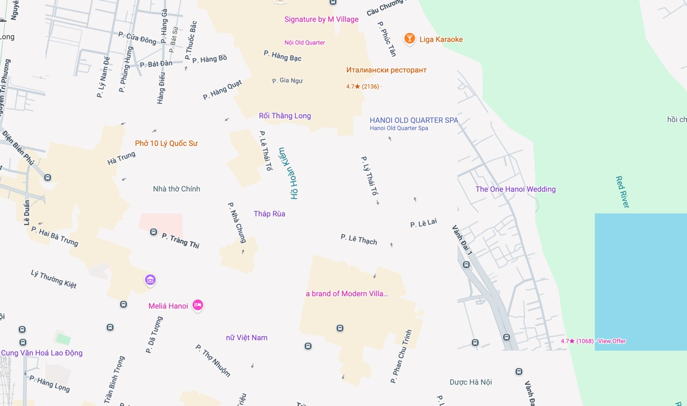
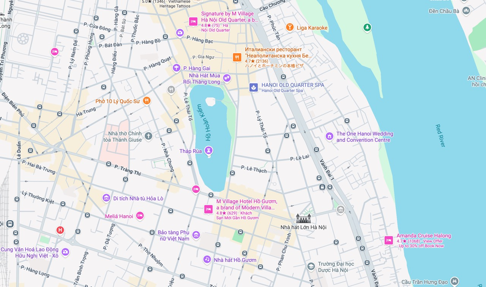
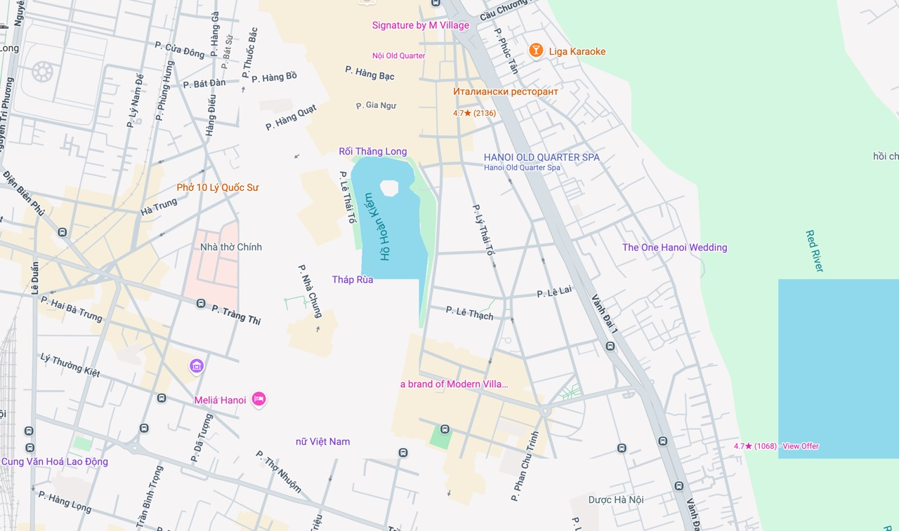

# Google Maps (and WebGL) on the 890M: broken strokes

Status 2026-11-18: root cause found. The fix is on two fork branches, compile-checked and unit-tested. It is **not
installed**: main builds and installs it.

## Summary

- **Owner report:** on the 890M, Google Maps in Chrome draws broken, missing strokes and lags.
- **Root cause:** the plugin and the installed translator disagree about which buffers reach the address table.
  - The translator in use since 2026-11-07 (2da7b21, carrying upstream NullMoth 1e49d8c) keeps data-indexed
    runtime-array buffers on their bounds-checked descriptors.
  - The plugin (6797e1f) still gives every buffer slot bound at an offset that is not a multiple of a fixed 16 the
    *dummy* descriptor. The 16 is NVIDIA's `minStorageBufferOffsetAlignment`; RADV's is 4. The plugin assumes "the
    address table carries it", which no longer holds.
  - So a kept buffer bound off that grid reads zeros.
- **How Maps hits it:**
  - ANGLE (Chrome's GL layer) must re-pack `GL_UNSIGNED_SHORT` draws at byte offsets that are 2 mod 4, because Metal
    needs index offsets aligned to 4.
  - It does this with its compute kernel `fixIndexBuffer`, which reads the index buffer bound at the unaligned offset
    (e.g. 414 or 438).
  - That kernel keeps its index buffer on a descriptor. It read zeros, so every re-packed draw became degenerate
    triangles: road and water strokes vanished, tile by tile.
- **Fix:**
  - The plugin uses the device's real descriptor offset grid (4).
  - For a compute dispatch that binds a kept buffer off that grid (2 mod 4), the plugin switches to the kernel's
    variant with every buffer lowered to the address table. The translator gets the flag and an export for this.
- **Not a workaround:** nothing is disabled, and no path moves to software.

## 1. Repro

Repro machine state:
- Boot 2026-11-18 ~08:54. NMXGPU out-29, Balanced on AC, Docker off, RTX gated (Eco).
- chrome://gpu, recorded headless from the same profile and saved in `~/ga403-logs/maps-webgl/chrome-gpu-20261118.txt`:
  - Chrome 157.0.8103.79, ANGLE c56e2a4a9b8c.
  - GPU0 is the only GPU: `ANGLE Metal Renderer: AMD Radeon 890M Graphics (RADV STRIX1) (NVMTL over …)`.
  - `GL implementation parts (gl=egl-angle,angle=metal)`. WebGL, WebGPU, rasterization and canvas are all hardware
    accelerated. Max MSAA is 8. Skia is Graphite on Dawn/Metal.
  - No GPU1 is listed (RTX gated).

Steps (headless, so no focus change):

```
tools/890m/webgl-repro/headless.sh ~/ga403-logs/maps-webgl/prof-r890 9511           # 890M (ANGLE Metal)
tools/890m/webgl-repro/headless.sh ~/ga403-logs/maps-webgl/prof-rss 9512 --use-angle=swiftshader --enable-unsafe-swiftshader
node tools/890m/webgl-repro/serve.mjs 9590 tools/890m/webgl-repro ~/ga403-logs/maps-webgl
node tools/890m/webgl-repro/capture.mjs 9511 ~/ga403-logs/maps-webgl/cap7.bin 'https://www.google.com/maps/@21.0285,105.8542,16z' 14
```

`capture.mjs` attaches to Maps' worker, where Maps draws through OffscreenCanvas WebGL2. It records every WebGL call
with its data and writes a screenshot. Then the capture is replayed into a plain page:

```
node tools/890m/webgl-repro/replay.mjs 9511 http://127.0.0.1:9590 cap7.bin rep-890m.png size=2560x1514
node tools/890m/webgl-repro/replay.mjs 9512 http://127.0.0.1:9590 cap7.bin rep-ss.png   size=2560x1514
node tools/890m/webgl-repro/bisect.mjs 9511 9512 http://127.0.0.1:9590 cap7.bin           # first draw that differs
```

- **Capture cap7:** 55935 calls, 9142 draws, 73 frames, 22.8 MB.
- **Replay:** deterministic. Live Maps breaks only some of the time, but the replay breaks every time.

| live capture (890M) | replay on the 890M | replay on SwiftShader (reference) | 890M, unaligned draws re-packed by the page |
|---|---|---|---|
|  |  |  |  |

- **Bisect:** the first wrong draw is #997 (call 13053).
  - Program 481 (road/line material), `drawElementsInstanced(TRIANGLES, 39, UNSIGNED_SHORT, 414)`.
  - Index buffer #314: 492 bytes, STATIC_DRAW, written once.
  - Every frame draws it once at offset 0 and once at offset 414. The first three repetitions are right; the fourth
    (frame 41) is wrong.
  - So ANGLE first re-packs from its CPU copy and later on the GPU.
- **`alignIdx=1` replay:** `replay.html` itself copies every 2-mod-4 index range to offset 0 before drawing, so ANGLE
  never re-packs. It restores the roads, the lake and most of the map. That points at the re-pack, not at Maps'
  shaders, textures or uniforms.
- **Remaining gap:** a few tiles and POI icons still differ in that run. See section 7.

## 2. A/B (which layer)

| run | result | points at |
|---|---|---|
| SwiftShader (`--use-angle=swiftshader`) | correct, but Maps takes another path (no worker WebGL2) | reference image only |
| replay of the same calls: 890M vs SwiftShader | 890M broken from draw #997, SwiftShader correct | our stack below WebGL, not Maps' content |
| replay with 2-mod-4 index ranges moved to offset 0 (`alignIdx=1`) | most strokes back | ANGLE's index re-pack path |
| plugin knobs `NVMTL_NO_DESCCACHE, NO_BUFREUSE, NO_DIRTYONLY, COMMIT_AHEAD=0, NO_ALIGN_GUARD, NO_BINDLESS, NO_POOL_REUSE, BUFPARK=0`, caches off | no change | not the plugin caches |
| style-texture upload contents (readPixels shadow-verify) | identical | not texture upload |
| GPU raster on/off, MSAA, WebGL1 vs 2 | sub-tests pass both ways (section 3) | not raster, MSAA or the WebGL version |
| Metal compute test, buffer at offsets 0..32768 (`metal/offset-matrix.m`) | **reads 0 at offsets 2, 4, 8, 438**, right at 0, 16, 64, 256, 512, 4096, 32768 | plugin descriptor writer + translator kept roots |

## 3. Minimal repro (PASS/FAIL now, before the fix)

**a) Metal, the minimal case:** `tools/890m/webgl-repro/metal/offset-matrix.m`. It builds with
`xcrun clang -fobjc-arc -o offset-matrix offset-matrix.m -framework Metal -framework Foundation`; the binary is in
`~/ga403-logs/maps-webgl/offset-matrix`.

- Each kernel copies `in[i]` (index bounds-checked against a constant) from a buffer bound with `setBuffer:offset:`.
- `ushort-offset.m` is the same check for one ushort kernel.

| kernel | offset 0 | 2 | 4 | 8 | 16 | 64 | 256 | 438 | 512 | 4096 | 32768 |
|---|---|---|---|---|---|---|---|---|---|---|---|
| r16c `device const ushort*` | PASS | FAIL | FAIL | FAIL | PASS | PASS | PASS | FAIL | PASS | PASS | PASS |
| r16w `device ushort*` | PASS | FAIL | FAIL | FAIL | PASS | PASS | PASS | FAIL | PASS | PASS | PASS |
| r32c `device const uint*` | PASS | n/a | FAIL | FAIL | PASS | PASS | PASS | n/a | PASS | PASS | PASS |
| r16k `constant ushort*` | PASS | FAIL | FAIL | FAIL | PASS | PASS | PASS | FAIL | PASS | PASS | PASS |

The program prints `14 failing`. FAIL means every element read 0; n/a means an offset that is not a multiple of 4 for a uint buffer, which Metal does not allow. Expected after the fix: all PASS. Offsets 4 and 8 are fixed by the 4-byte grid;
offsets 2 and 438 by the all-lowered variant.

**b) WebGL capture replay:** `replay.html?trace=cap7.bin&size=2560x1514` (section 1). It FAILs at draw #997 today.

**c) WebGL sub-tests:** `tools/890m/webgl-repro/index.html` runs 45 tests, one per feature Maps uses. Run them with
`node run.mjs <port> http://127.0.0.1:9590/index.html[?only=…]`.

- All 45 PASS (45/45 on the 890M on 2026-11-18) on the 890M and on SwiftShader. The list:
  - UBO ranges and rewrites, instancing, constant attributes, short attributes
  - texStorage3D formats, large index/VAO offsets, per-tile stencil, D32F+S8
  - 4096 UBO slices, PBO + fence, divisors, a 3584x2048 target
  - cross-flush rewrites of vertex, uniform, index buffers and textures
  - vertex-texture presence over 12 frames
  - unaligned (2 mod 4) index offsets: small, 8 MB, dynamic, GPU-copied, after an aligned draw, flushed
  - Maps' exact 492-byte pattern over 60 frames
- They show what is *not* broken. None of them gets Chrome's ANGLE to choose the GPU re-pack. Chrome keeps a CPU copy
  of every element-array buffer for WebGL validation, and ANGLE re-packs from it. Which condition switched Maps to the
  GPU kernel at frame 41 is still open.
- So the failing minimal cases are (a) and (b). After the fix (c) must stay all PASS.

## 4. Root cause

Chain: Maps (Filament, worker OffscreenCanvas WebGL2) → Chrome ANGLE Metal → NVMTL plugin → translator (AIR → SPIR-V,
then address lowering) → RADV → NMXGPU.

1. **ANGLE's re-pack.** A `drawElements*(…, GL_UNSIGNED_SHORT, offset)` with `offset % 4 == 2` cannot be bound as a
   Metal index buffer. ANGLE runs `fixIndexBuffer`, an internal kernel. For Maps the function constant
   `fixIndexBufferKey` is 10 (ushort in, ushort out). The kernel reads `indexBufferUint16` bound at the draw's offset
   (414, 438, 498 …) and writes a fresh index buffer.
2. **Translator, `translator/wrapper/src/buffer_addresses.rs`, `lower_addresses` → `kept_roots` (2da7b21, from
   upstream 1e49d8c "World of Warcraft starts again").** A buffer whose block is a runtime array indexed with a
   data-dependent value stays a descriptor; every other buffer moves to the address table (binding 640). In
   `fixIndexBuffer` the index depends on `indexCount`/`primCount` from another buffer, so buffer 0 stays a descriptor.
   - Checked with the installed translator dylib on ANGLE's own AIR (aircache `6772aa07…`): key 10 gives kept mask
     0x3. After lowering, binding 0 is still a StorageBuffer descriptor.
3. **Plugin, `plugin/nvmtl_vk.c`, the descriptor-set writer (`NVMTL_SSBO_ALIGN 16`, the `sl->off % NVMTL_SSBO_ALIGN`
   branch).** Any buffer slot whose offset is not a multiple of 16 gets `dummyB`. The log line there says the slot is
   "reachable only through the address table", which was true before kept roots existed.
   - `nvmtl_address_snapshot` does put the right address (`address + off`) in the table, but a kept buffer never reads
     the table.
   - With `robustBufferAccess` on, reads from the dummy return 0.
4. **Result.** The re-packed index buffer is all zeros, so each line draw collapses to vertex 0: degenerate
   triangles, so the strokes go missing. Draws that ANGLE re-packed on the CPU (the first frames), and aligned draws,
   stay right. That is why the damage moves around and comes per tile.

**Why 16:** the plugin started on NVIDIA, where `minStorageBufferOffsetAlignment` is 16. On RADV it is 4. Even without
kept roots, the 16 sent offsets 4, 8 and 12 to the dummy for no reason.

**Lag.** This is an estimate; it was not measured on this boot.
- In the capture, 47 of the draws in each content frame are 2-mod-4 ushort draws (1081 in the load).
- Each one is an ANGLE compute dispatch in the middle of the frame's render pass. ANGLE ends the render encoder,
  dispatches, and starts a new encoder.
- On our IMR path every Metal render encoder is a Vulkan render pass that stores and reloads its attachments. Maps'
  attachments are 2560x1514 R11G11B10F (15.5 MB) plus D32F+S8 (~19 MB), so each split costs ~70 MB of traffic. Up
  to 47 splits a frame is ~3 GB per frame, enough to take a large share of the 890M's bandwidth and drop Maps well
  under 60 fps while panning.
- The zero reads do not cause the lag; the splits do, and the fix does not remove them.
- To measure after install: per-frame render-pass and encoder counts in the GPU process while panning, with and
  without the replay's `alignIdx=1`.
- A follow-up could make the plugin cheaper for compute-between-render patterns, e.g. keep attachments resident.
  That is a performance item, not this bug.

## 5. Fix (branches and commits; not installed)

Fork `thanhnndev/nvidia-macos-driver`. Each branch is one commit on top of what is installed.

| branch | base (installed) | commit | what |
|---|---|---|---|
| `fix/maps-kept-roots-xlate` | 2da7b21 (translator-renderbox-vfn, live since 2026-11-07 15:40, tag eb6acb2af570f9ab) | 6208982 | `lower_opts(bytes, keep_runtime_arrays)`; `nvmtl_lower_buffer_addresses_ex/_g2` flag 16 = LOWER_ALL; new export `nvmtl_kept_descriptor_mask`; test `a_data_indexed_runtime_array_is_kept_unless_everything_is_lowered` |
| `fix/maps-ssbo-offset` | 6797e1f (plugin/video-lag, live plugin UUID 0106C6CD) | e4ea8af | descriptor grid = device `minStorageBufferOffsetAlignment` (log line at first use; `NVMTL_SSBO_ALIGN` overrides, never below the device value); compute pipelines record their kept mask; `nvmtl_kept_pick` runs the LOWER_ALL+SAFE variant for a dispatch that binds a kept buffer off the grid; the variant is freed with its pipeline |

Checks done:
- **Translator:** `cargo build --release` OK.
- **Translator unit tests:** `cargo test --release buffer_addresses` gives 7 passed and 1 ignored (corpus), including
  the new test. `cc` was pinned locally to a cached version for the offline dev-dependency build; Cargo.lock is not
  committed.
- **New dylib on the real modules** (`~/ga403-logs/maps-webgl/lower/`):
  - r16c, r16w, r32c, r16k: kept mask 0x3. Flags 0: unlowered. Flag 16: both buffers through `ConvertUToPtr`, no
    StorageBuffer bindings left.
  - ANGLE `fixIndexBuffer` key 10: kept 0x3. Flag 16: binding 0 lowered.
- **Plugin:** compiles and links with the build script's flags plus `-framework IOKit`, and with
  `-I nmx-plugin-890m/out/vk/include` because `~/Vulkan-Headers` does not exist. No errors.
- **Not run:** the plugin on the GPU. A live A/B needs both pieces installed, since the plugin loads the translator
  from the bundle and has no env switch for that path.

Behaviour notes:
- **With the old translator:** the new plugin only changes the grid to 4. Without `nvmtl_kept_descriptor_mask` it
  never builds variants.
- **Bounds check in the variant:** the LOWER_ALL variant drops the descriptor bounds check, for that dispatch only.
  Before the fix the same dispatch read nothing, so this only trades zeros for Metal's exact semantics. The WoW case
  that motivated kept roots (a fragment shader) is untouched: render stages are not switched.
- **Render stages:** a kept buffer bound at 2 mod 4 in a vertex or fragment shader still reads the dummy. It is
  logged, with a counter. Nothing in Maps needed it. Moving render stages to a per-draw variant is possible (same
  idea, keyed per pipeline) if the log shows it in use.

## 6. What main must install, and how to verify

1. **Build:** the translator from `fix/maps-kept-roots-xlate` (`build/build_xlate.sh` flow) and the plugin from
   `fix/maps-ssbo-offset` (`build/build_plugin.sh`). If the LIVE tree lacks `~/Vulkan-Headers`, use the include path
   noted above.
2. **Install:**
   - translator: `scripts/macos-nvmtl-translator-install.sh`, then **`strixsbxmap --refresh`** (StrixSbxMap pins the
     translator cdhash)
   - plugin: the usual plugin install
   - No reboot is needed for apps started afterwards. WindowServer picks the new plugin up at the next boot.
   - Undo: `--undo` of each installer.
3. **Verify, in order. Each step is cheap and can run headless.**
   - `~/ga403-logs/maps-webgl/offset-matrix`: every cell `ok`.
     - `$TMPDIR/nvmtl.log` must show `storage-buffer descriptors take offsets that are multiples of 4`.
     - It must also show `kept descriptors: buffer 0 … is bound at offset 2 … all-lowered module`.
   - Replay against SwiftShader. Expected: no differing draw, or only the remainder noted in section 7.
     - `node tools/890m/webgl-repro/replay.mjs 9511 http://127.0.0.1:9590 cap7.bin after.png size=2560x1514`
     - then `bisect.mjs 9511 9512 …`
   - `node tools/890m/webgl-repro/run.mjs 9511 http://127.0.0.1:9590/index.html`: 45/45 PASS (regression check).
   - Live: Google Maps in a scratch Chrome profile, Hanoi at zoom 14-17, pan and zoom for a minute. Roads, the lake and
     the river must stay continuous. Note the panning frame rate for the lag item.
   - Regression: WindowServer, Safari WebGL probe, Chrome video (VCN path), and `log show --last 5m | grep -i 'NVMTL.*kept descriptors\|REFUSED'`.

## 7. Open points, and earlier assumptions that were wrong

- **Remainder after the re-pack fix:** in the `alignIdx=1` replay a few tiles, POI icons and part of the lake (south
  of Tháp Rùa) still differ. Candidates:
  - another ANGLE conversion kernel on a kept buffer (vertex-format conversion, line-loop or primitive-restart
    paths). The compute fix covers these too.
  - a render-stage kept buffer at 2 mod 4. The plugin now logs it.
  - Re-bisect after install to tell them apart.
- **Wrong assumption 1:** the plugin log text "reachable only through the address table". Since 1e49d8c (Oct 21) the
  translator keeps some buffers on descriptors, so the line misled every earlier reading of it.
  - Step117 (Zalo) logged `buffer slot 0 is bound at offset 108, not a multiple of 16` and moved on.
  - 108 is a multiple of 4, so the 4-byte grid alone would have given that slot its real descriptor.
- **Wrong assumption 2:** that the installed translator matches the plugin's source tree. It does not.
  - The live translator is 2da7b21 (translator-renderbox-vfn, installed for the simulator work); the live plugin is
    6797e1f (plugin/video-lag).
  - The 6797e1f tree's own translator lowers every buffer, and the live one does not.
  - Any future A/B has to name both.
- **Wrong assumption 3:** that the WebGL sub-tests reach the bug. Chrome re-packs most unaligned index draws on the
  CPU, so per-feature WebGL tests pass while Maps breaks. The capture/replay and the Metal test are the instruments
  that reach the driver path.

## 8. Other software likely affected

- **WebGL in Chrome** (and every Chromium ≥ 115 browser and Electron app on the 890M: Claude 45.2.1/Chrome 156,
  VS Code 43.8.3/Chrome 150, Termius 43.8.1/Chrome 150, vesktop 45.2.3/Chrome 156, versions read from their bundles;
  none launched):
  - any page that draws `UNSIGNED_SHORT` index ranges starting at an odd element of a shared index buffer, which gives
    byte offsets 2 mod 4.
  - Typical sources: vector maps (Google Maps, Mapbox GL / MapLibre, OpenLayers WebGL), CesiumJS, deck.gl, three.js
    and Babylon.js geometry groups or draw ranges, Unity/Godot WebGL sub-meshes.
- **Metal apps and games:** any compute kernel that indexes a runtime array with data from memory while the buffer is
  bound at an offset that is not a multiple of 16 (before the fix) or of 4 (after the fix, compute is fixed).
- **Old Electron and plain OpenGL apps** (Chromium < 115, e.g. Zalo 22.3.9 in Step117): they go through Apple's
  GL-on-Metal and our GL bridge, not ANGLE Metal.
  - The bridge binds buffers at ring offsets such as 108 (Step117 log), which hit the same dummy-descriptor rule.
  - The 4-byte grid should fix those slots in every stage. This is a strong candidate for Step117's wrong colours and
    missing elements, but it is unverified: Zalo is not installed now.
  - Recheck with any GL app after install.
- **Safari / WebKit (not opened; prediction only):** WebKit's WebGL is ANGLE Metal too, with the same internal shaders
  (`fixIndexBuffer` and friends), in the WebKit GPU process (StrixSbxMap).
  - The same pages should break the same way before the fix and be fixed by it.
  - Expected differences: WebKit's choice of CPU vs GPU re-pack, and the GPU-process sandbox, which does not touch
    this path.

## Files

- `tools/890m/webgl-repro/`:
  - `index.html` + `tests.js` (sub-tests), `run.mjs` (CDP runner), `headless.sh`, `serve.mjs`
  - `capture-hook.js` + `capture.mjs` (worker WebGL capture)
  - `replay.html` / `replay.js` / `replay.mjs`, `bisect.mjs`
  - `trace-info.mjs`, `trace-shaders.mjs`, `trace-draw.mjs`
  - `metal/offset-matrix.m`, `metal/ushort-offset.m`
- Data (not in git): `~/ga403-logs/maps-webgl/`
  - `cap7.bin`, replays, `bisect7.txt`, `shaders/`, `chrome-gpu-20261118.txt`
  - `lower/`: translator harnesses `lower.c`, `kept.c`, `fc.c`, `dis.py`, plus the SPIR-V before and after
